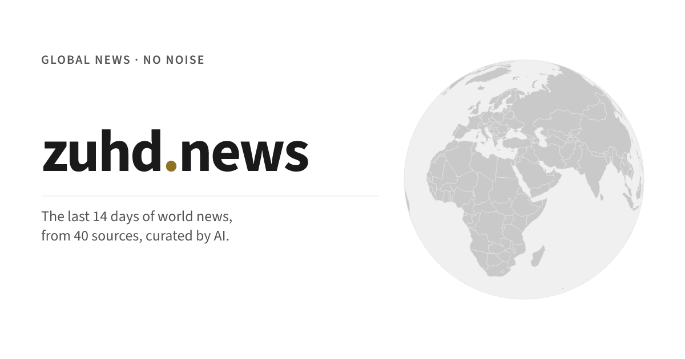
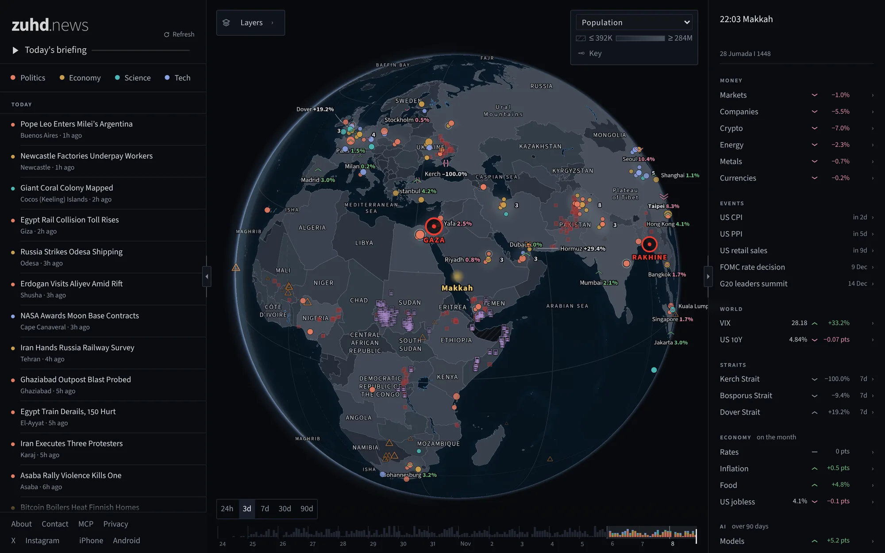
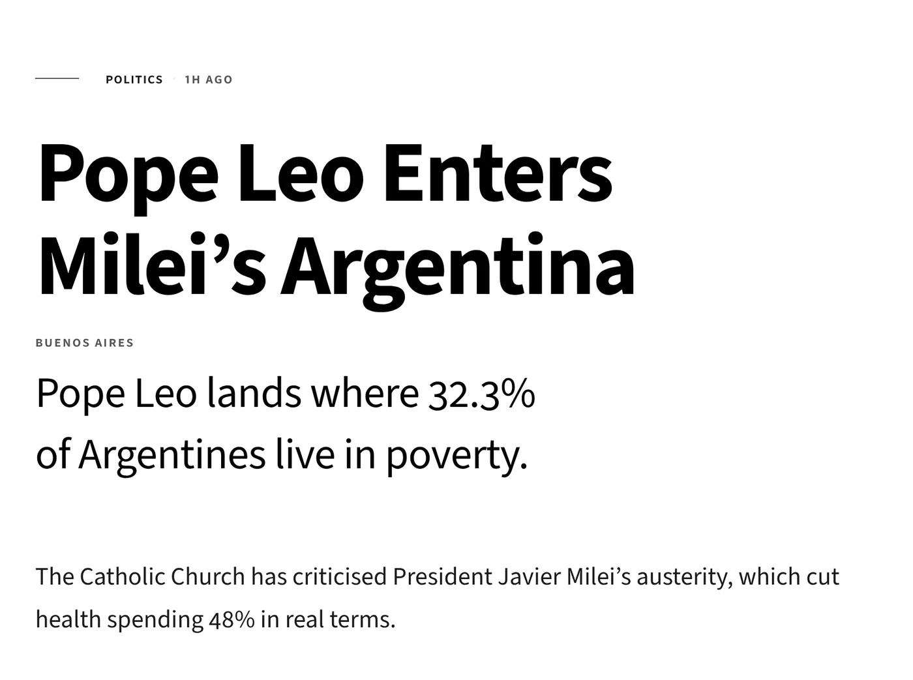
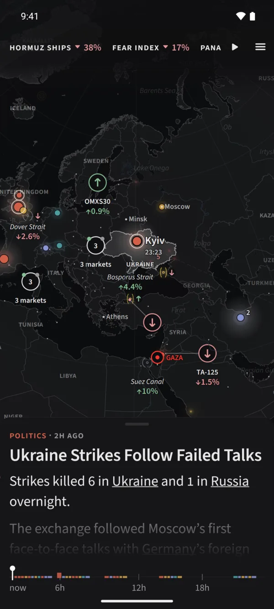
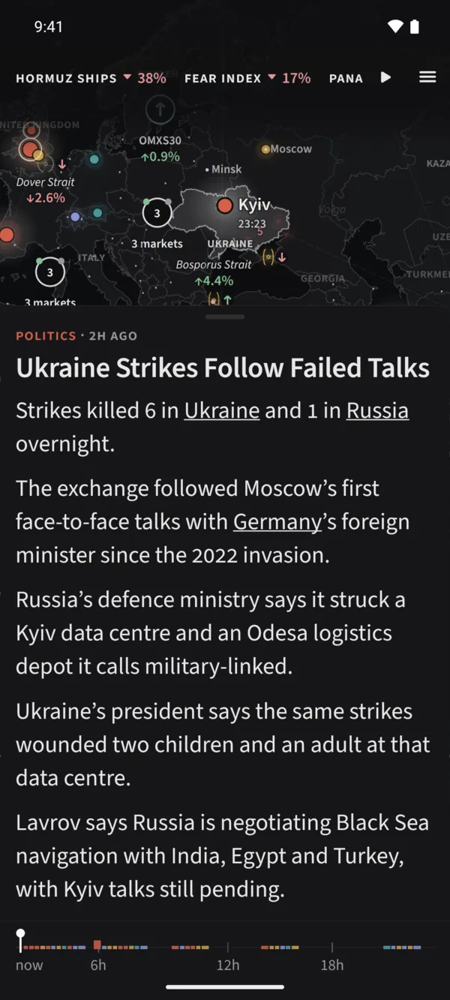
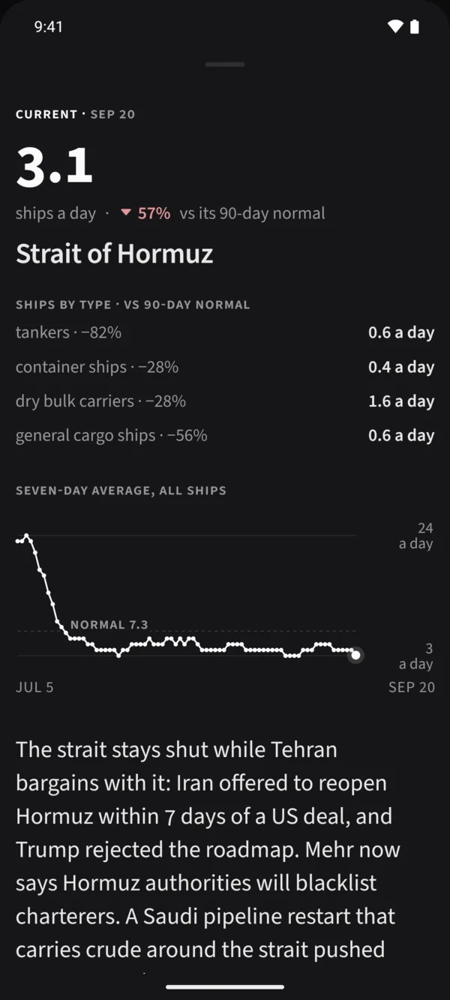
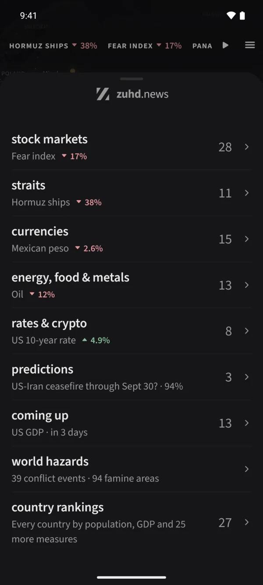
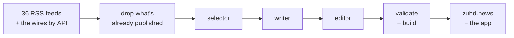

<p align="center">
  <a href="https://zuhd.news">
    <picture>
      <source media="(prefers-color-scheme: dark)" srcset=".github/readme/card-dark.png">
      
    </picture>
  </a>
</p>

<p align="center">
  An automated newsroom. Five times a day it reads the world,<br>
  writes what happened, why it matters and what comes next, then stops.
</p>

<p align="center">
  <a href="https://zuhd.news"><b>zuhd.news</b></a> ·
  <a href="https://apps.apple.com/app/id6760964753">iPhone</a> ·
  <a href="https://play.google.com/store/apps/details?id=news.zuhd.app">Android</a> ·
  <a href="https://zuhd.news/mcp">MCP</a> ·
  <a href="foundation.md">Foundation</a>
</p>

<p align="center">
  <a href="https://github.com/YunusAndreasson/zuhd.news/actions/workflows/checks.yml"></a>
  <a href="https://github.com/YunusAndreasson/zuhd.news/commits/master"></a>
  <a href="https://apps.apple.com/app/id6760964753"></a>
  <a href="https://play.google.com/store/apps/details?id=news.zuhd.app"></a>
</p>

<br>



## Read it

- **On the web** at [zuhd.news](https://zuhd.news): the map on a desktop, and
  each article on a page of its own.
- **In the app**, for [iPhone](https://apps.apple.com/app/id6760964753) and
  [Android](https://play.google.com/store/apps/details?id=news.zuhd.app): the
  same stories over a globe you turn with a finger, one story at a time. No
  account.
- **By ear**: a spoken briefing of the day, under the wordmark on the homepage.
- **By feed**: [RSS](https://zuhd.news/feed.xml), or the JSON the app reads,
  [`/api/feed.json`](https://zuhd.news/api/feed.json).
- **From your agent**: a read-only MCP server at `https://mcp.zuhd.news/mcp`
  that searches the articles, follows a story's thread and shows which
  countries' press covered it. No key. [The tools](https://zuhd.news/mcp).

## What's in it

- **Four desks.** Politics, economy, science and tech: global hard news, in
  English.
- **The same short shape.** A hook, why it matters, how it happened, what comes
  next, then the sources. Nothing after that.
- **Isnad.** Every article ends with its chain of sources, named and linked.
  The newsroom looks for the voices closest to a story, and no more than two of
  its sources come from the Western press.
- **Corrections in the open.** A correction is dated and printed on the article
  itself, never a quiet edit.
- **The world around the story.** Conflict, famine, disasters, fires seen from
  space and the ships through each strait are marked on the globe where they
  happen. Markets, currencies, rates and inflation sit beside it.
- **Makkah time.** The clock in Makkah, the Hijri date, and the five prayer
  lines drawn across the globe.
- **Nothing to sell.** No ads, no investors, no social login, no algorithmic
  feed.

<p align="center">
  <picture>
    <source media="(prefers-color-scheme: dark)" srcset=".github/readme/article-dark.webp">
    
  </picture>
  <br>
  <sub>An article on the web: one typeface, and nothing on the page but the story.</sub>
</p>

<table>
  <tr>
    <td width="25%"></td>
    <td width="25%"></td>
    <td width="25%"></td>
    <td width="25%"></td>
  </tr>
  <tr>
    <td align="center"><sub><b>The map</b>, where it happened</sub></td>
    <td align="center"><sub><b>The story</b>, over the globe</sub></td>
    <td align="center"><sub><b>A strait</b>, against its normal</sub></td>
    <td align="center"><sub><b>The menu</b>, numbers first</sub></td>
  </tr>
</table>

## How the newsroom works

A cycle runs on one server at 05, 10, 14, 18 and 22 UTC.



The **selector** reads the merged feed and picks the stories worth a reader's
time. The **writer** drafts each one from its sources' text and the live data
attached to it. The **editor** checks the drafts against the house style.
Each runs through the `claude` CLI; smaller passes then name the places and
people, pick a chart and read each source's angle. The site is built, deployed
and committed to `master` as `zuhd.news editor`, so the history of `content/`
is the newsroom's log.

The cycle is a list of stages in
[`scripts/cycle/stages.js`](scripts/cycle/stages.js).
`node scripts/cycle/run.js --plan --at 22 --dow 7` prints what a given cycle
would run.

## Working on it

| Where | What |
|---|---|
| `public/` `templates/` `functions/` | the site, built by [`scripts/build.js`](scripts/build.js): no framework, markdown in, HTML out |
| `scripts/` `content/` | the pipeline, and the articles it writes as markdown with YAML frontmatter |
| `mobile/` | the app, in React Native and Expo, with its own commands |
| `shared/` | what the site and the app both draw: country data, the chart, the sun and the prayer lines |
| `workers/mcp/` | the MCP server |

```sh
npm install
npm run dev      # build, watch, and serve dist/ on localhost:8788
npm run verify   # lint, typecheck and test, before every commit
```

## Docs

- [Foundation](foundation.md): the philosophy and the design manifesto
- [DEV.md](DEV.md): hosting, sources, the environment and running the cycle
- [AGENTS.md](AGENTS.md): working in the repo, its commands and gotchas
- [The app](mobile/AGENTS.md) and its [design system](mobile/DESIGN.md)
- [The writer's prompt](scripts/write-prompt.md): the article's shape and every
  budget

## Under the hood

- [Claude Code](https://github.com/anthropics/claude-code), run headless, for
  the selector, writer and editor
- [MapLibre GL JS](https://github.com/maplibre/maplibre-gl-js) for the map, and
  [Preact](https://github.com/preactjs/preact) with
  [htm](https://github.com/developit/htm) for the site's islands
- [Natural Earth](https://www.naturalearthdata.com) for the borders, and
  [d3-geo](https://github.com/d3/d3-geo) with
  [resvg](https://github.com/thx/resvg-js) for the share cards
- [Readability](https://github.com/mozilla/readability) and
  [jsdom](https://github.com/jsdom/jsdom) to read a source's article
- [Expo](https://github.com/expo/expo),
  [React Native Skia](https://github.com/Shopify/react-native-skia),
  [Reanimated](https://github.com/software-mansion/react-native-reanimated) and
  [Gesture Handler](https://github.com/software-mansion/react-native-gesture-handler)
  for the app and its globe
- [Cloudflare Pages](https://pages.cloudflare.com) for the site, and a Worker
  with the [MCP TypeScript SDK](https://github.com/modelcontextprotocol/typescript-sdk)
  for the agent server
- [Source Sans 3](https://github.com/adobe-fonts/source-sans), the one typeface

The data comes from the World Bank, IMF PortWatch, FRED, UCDP, the IPC, GDACS,
NASA FIRMS, Polymarket, Our World in Data, V-Dem and others.

## The name

Zuhd (زهد) is the discipline of doing without what you do not need. In 1971
Herbert Simon observed that a wealth of information creates a poverty of
attention; seven centuries earlier, Ibn Taymiyyah had named the discipline:
abandon what does not bring benefit. [About](https://zuhd.news/about).

## License

[MIT](LICENSE).
